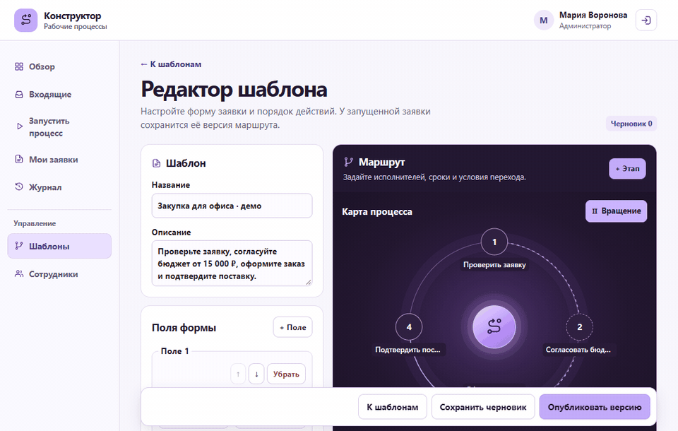
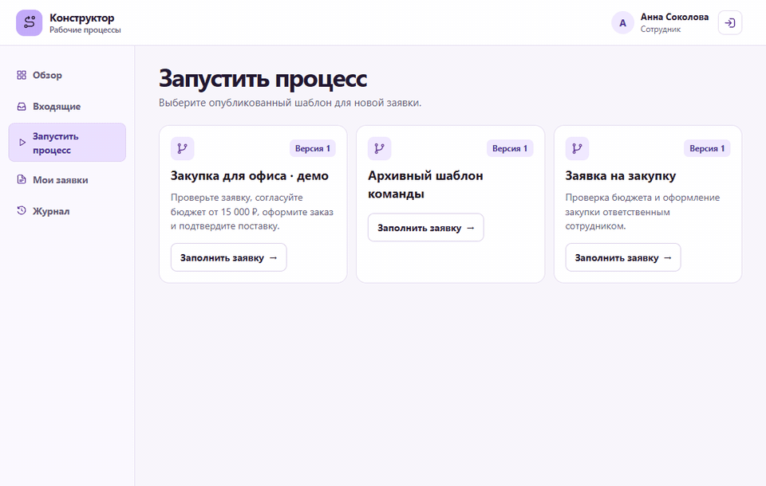
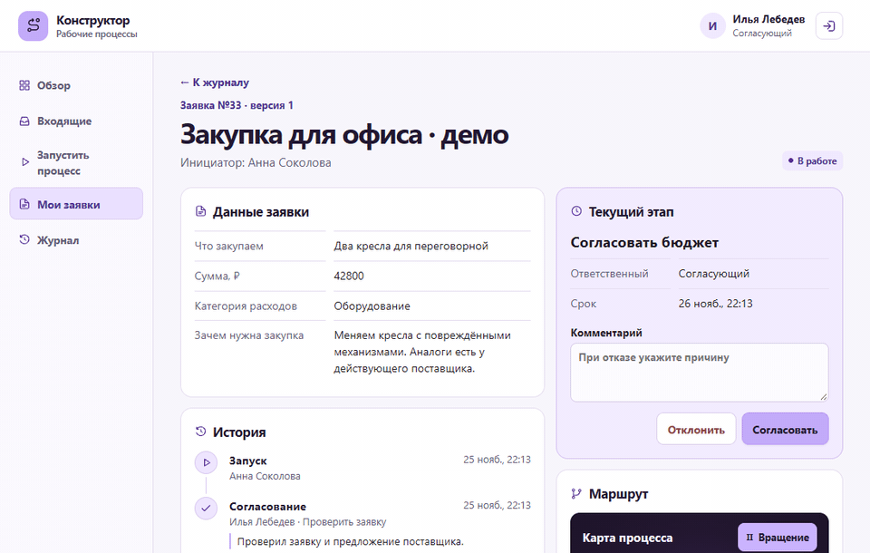
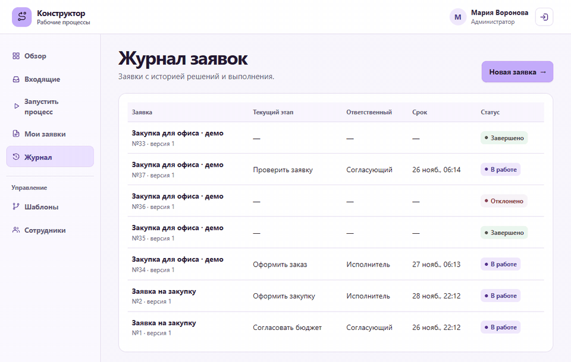

# Конструктор рабочих процессов

Заявки на закупку, доступ или внутренние услуги проходят по заданному маршруту. Сотрудник заполняет форму. Согласующий проверяет заявку, исполнитель получает следующий этап. В карточке видны ответственный, срок и история решений.

## Запустить демо на Windows

~~~powershell
.\Start-Constructor.ps1 -Demo -Build
~~~

Откройте [127.0.0.1:8095](http://127.0.0.1:8095). Для всех четырёх учебных аккаунтов используется пароль **WorkshopDemo!2026**.

| Роль | Почта |
| --- | --- |
| Администратор | admin@process.test |
| Сотрудник | employee@process.test |
| Согласующий | approver@process.test |
| Исполнитель | executor@process.test |

Откройте шаблон **«Закупка для офиса · демо»**. В нём четыре этапа. Проверка бюджета нужна при сумме от 15 000 ₽. Для меньшей суммы после общей проверки сразу начинается оформление заказа.

В журнале уже есть четыре заявки из учебного сценария. Кресла ждут решения по бюджету, кабель и крепёж переданы исполнителю, расходники получены, а в закупке экрана отказано. Демо хранится в `.run/demo/`. При первом запуске обновлённое демо добавит эти примеры один раз и сохранит существующие записи.

## 1. Настроить маршрут

Войдите администратором и откройте «Шаблоны». Укажите поля формы, порядок этапов, ответственных и сроки. Выберите этап на карте, чтобы увидеть детали или перейти к настройкам. Сохраните черновик или опубликуйте версию.

## 2. Отправить заявку

Войдите сотрудником и откройте «Запустить процесс». Выберите шаблон, укажите предмет закупки, сумму, категорию и цель. После отправки откроется карточка с первым этапом и сроком.

## 3. Согласовать и выполнить

Согласующий открывает заявку во «Входящих», пишет комментарий и подтверждает решение. При отказе нужно указать причину. Исполнитель оформляет заказ, затем инициатор подтверждает получение.

## 4. Посмотреть историю

В «Журнале» откройте нужную заявку. История показывает действия и комментарии участников. Карта отмечает выполненные и пропущенные этапы. Чтобы посмотреть их в порядке выполнения, откройте «Этапы списком».

## Рабочая установка

Нужны Java 21 и Maven. Перед первым запуском задайте в окружении `PROCESS_ADMIN_EMAIL` и `PROCESS_ADMIN_PASSWORD`. Используйте уникальный пароль от 14 символов. Имя можно задать через `PROCESS_ADMIN_NAME`.

~~~powershell
.\Start-Constructor.ps1 -Build
~~~

Остальные аккаунты администратор добавляет в разделе «Сотрудники». Рабочие данные находятся в `data/processes.mv.db`. Для резервной копии остановите приложение и сохраните этот файл. Порт меняется через параметр `-Port`, часовой пояс через `PROCESS_ZONE`. По умолчанию используется `Europe/Moscow`.

Один шаблон содержит до 12 полей и 12 этапов. Условие может пропустить этап маршрута. При запуске заявка сохраняет опубликованную версию шаблона. Двойная отправка одной формы с теми же данными открывает ту же заявку.

Запуск рассчитан на один процесс приложения с локальной базой H2. Проверка и сборка выполняются через `mvn test` и `mvn package`. Исполняемый файл находится в `target/process-builder.jar`.

